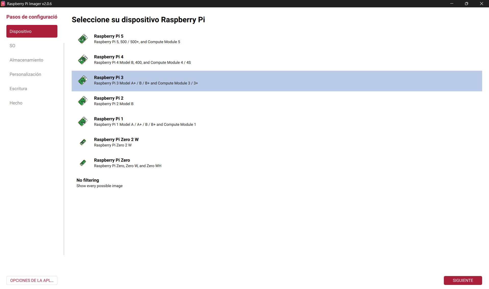
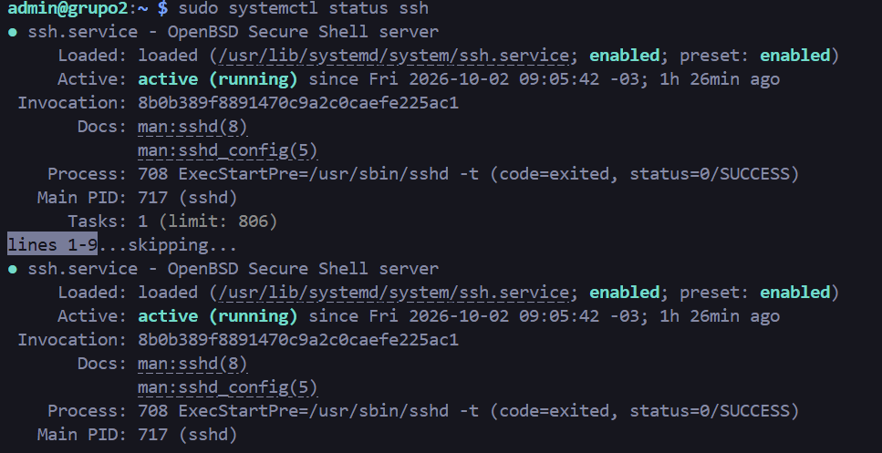
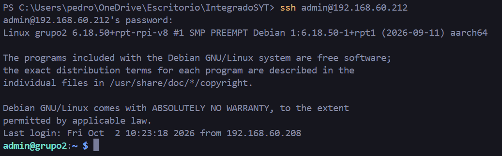

# Instalación de Raspberry Pi OS y activación del servicio SSH

## Índice

- [Instalación de Raspberry Pi OS y activación del servicio SSH](#instalación-de-raspberry-pi-os-y-activación-del-servicio-ssh)
  - [Índice](#índice)
  - [1. Introducción](#1-introducción)
  - [2. Objetivo](#2-objetivo)
  - [3. Marco teórico](#3-marco-teórico)
  - [4. Materiales utilizados](#4-materiales-utilizados)
  - [5. Instalación del sistema operativo](#5-instalación-del-sistema-operativo)
    - [Evidencia](#evidencia)
  - [6. Configuración de red](#6-configuración-de-red)
    - [Evidencia](#evidencia-1)
  - [7. Configuración y activación de SSH](#7-configuración-y-activación-de-ssh)
    - [Evidencia](#evidencia-2)
  - [8. Conexión remota mediante SSH](#8-conexión-remota-mediante-ssh)
    - [Evidencia](#evidencia-3)
  - [9. Verificación del funcionamiento](#9-verificación-del-funcionamiento)
  - [10. Conclusión](#10-conclusión)

---

## 1. Introducción

En esta primera etapa del trabajo se preparó una Raspberry Pi para utilizarla, más adelante, como servidor dentro de una red local. Para eso se instaló desde cero **Raspberry Pi OS**, en su versión **sin entorno de escritorio** (solo terminal), ya que administrar el equipo por línea de comandos consume menos recursos y es más adecuado para un servidor.

Una vez instalado el sistema, se habilitó el servicio **SSH (Secure Shell)**, que permite conectarse de forma remota y segura a la Raspberry Pi desde otra computadora de la misma red.

---

## 2. Objetivo

Instalar y configurar desde cero el sistema operativo de una Raspberry Pi para utilizarla como servidor en una red local, y habilitar el servicio SSH para poder administrarla de forma remota.

Objetivos específicos:

- Instalar Raspberry Pi OS sin entorno de escritorio.
- Configurar los parámetros básicos del sistema (usuario, nombre de equipo, red).
- Identificar la dirección IP asignada a la Raspberry Pi.
- Habilitar y verificar el funcionamiento del servicio SSH.
- Conectarse de forma remota desde otro equipo y comprobar el acceso.

---

## 3. Marco teórico

**Raspberry Pi:** computadora de placa única (*Single Board Computer*). Pese a su tamaño reducido, cuenta con procesador, memoria RAM, puertos y conexión de red suficientes para ejecutar un sistema operativo completo. En este trabajo cumplirá el rol de servidor dentro de una red local.

**Sistema operativo:** software encargado de administrar los recursos de hardware (procesador, memoria, almacenamiento, red) y de permitir la ejecución de programas y servicios.

**Raspberry Pi OS:** sistema operativo basado en Debian, desarrollado específicamente para dispositivos Raspberry Pi. Existe en distintas variantes; en este trabajo se utiliza la versión **sin entorno gráfico**, administrable solo por línea de comandos, ya que el equipo funcionará como servidor.

**Servidor:** dispositivo o programa que ofrece servicios o recursos a otros equipos (clientes) a través de una red. La Raspberry Pi cumplirá este rol frente a las demás computadoras de la red local.

**Red local (LAN):** red que conecta dispositivos dentro de un espacio determinado (hogar, laboratorio, etc.). Permite que los distintos equipos se comuniquen entre sí mediante su dirección IP.

**Dirección IP:** identificador numérico (por ejemplo `192.168.1.50`) que permite ubicar a un dispositivo dentro de una red y establecer conexiones hacia él.

**SSH (Secure Shell):** protocolo que permite establecer conexiones remotas y seguras entre dos equipos, cifrando la comunicación y autenticando al usuario. Permite ejecutar comandos en un equipo remoto (la Raspberry Pi) desde una computadora cliente, sin necesidad de estar físicamente frente a él.

---

## 4. Materiales utilizados

- Raspberry Pi.
- Tarjeta microSD.
- Computadora para preparar la tarjeta microSD.
- Fuente de alimentación y conexión de red para la Raspberry Pi.
- Software **Raspberry Pi Imager**.

| Elemento | Dato |
|---|---|
| Modelo de Raspberry Pi | [raspberry pi 3 B+] |
| Sistema operativo | Raspberry Pi OS (sin entorno de escritorio) |
| Usuario creado | [admin] |
| Nombre del equipo | [grupo2] |
| Dirección IP | [192.168.60.212] |

---

## 5. Instalación del sistema operativo

Se utilizó **Raspberry Pi Imager** para escribir el sistema operativo en la tarjeta microSD. Los pasos realizados fueron:

1. **Preparación de la tarjeta microSD:** se conectó la tarjeta a la computadora, verificando que fuera la correcta (el proceso borra los datos existentes).
2. **Selección del sistema operativo:** desde el Imager se eligió Raspberry Pi OS en su versión **sin entorno de escritorio (Lite)**, requisito de la actividad al usarse la Raspberry Pi como servidor.
3. **Escritura en la tarjeta:** se seleccionó la microSD como destino y se inició el proceso de grabación del sistema.
4. **Configuración inicial:** durante la preparación se definieron nombre de equipo, usuario, contraseña, red y activación de SSH (disponibles como opciones avanzadas del Imager).
5. **Primer arranque:** se insertó la tarjeta en la Raspberry Pi y se encendió el equipo. Al iniciar, el sistema mostró directamente una terminal (sin escritorio), similar a:

```text
admin@grupo2:~$
```

### Evidencia




---

## 6. Configuración de red

Con la Raspberry Pi conectada a la red local, se consultó la dirección IP asignada mediante:

```bash
hostname -I
```

**Explicación del comando:**

- `hostname`: comando que muestra información de identificación del equipo.
- `-I`: opción que muestra las direcciones IP asignadas al equipo.

Resultado obtenido:

```text
[192.168.60.212]
```

Esta dirección IP es la que se utilizará más adelante para conectarse por SSH, ya que identifica a la Raspberry Pi dentro de la red local.

### Evidencia


---

## 7. Configuración y activación de SSH

Se comprobó el estado del servicio SSH con:

```bash
sudo systemctl status ssh
```

**Explicación del comando:**

- `sudo`: ejecuta el comando con privilegios administrativos.
- `systemctl`: herramienta para controlar y consultar servicios gestionados por `systemd`.
- `status`: muestra el estado actual del servicio indicado.
- `ssh`: nombre del servicio que se desea consultar.

Si el servicio no estuviera activo, se inicia con:

```bash
sudo systemctl start ssh
```

- `start`: inicia el servicio indicado inmediatamente.

Y para que se inicie automáticamente en cada arranque del equipo:

```bash
sudo systemctl enable ssh
```

- `enable`: configura el servicio para que arranque junto con el sistema.

Resultado obtenido:

```text
[
    admin@grupo2:~ $ sudo systemctl status ssh
    [sudo] password for admin: 
    ● ssh.service - OpenBSD Secure Shell server
        Loaded: loaded (/usr/lib/systemd/system/ssh.service; enabled; preset: enabled)
        Active: active (running) since Fri 2026-10-02 09:05:42 -03; 1h 18min ago
]
```

### Evidencia



---

## 8. Conexión remota mediante SSH

Desde otra computadora de la misma red se realizó la conexión con:

```bash
ssh admin@192.168.60.212
```

**Explicación del comando:**

- `ssh`: indica que se establecerá una conexión mediante el protocolo SSH.
- `usuario`: nombre de usuario existente en la Raspberry Pi.
- `@`: separa el usuario de la dirección del equipo remoto.
- `192.168.60.212`: dirección IP de la Raspberry Pi (destino de la conexión).

Al ejecutar el comando se solicitó la contraseña del usuario; una vez autenticado, se obtuvo acceso a la terminal de la Raspberry Pi en forma remota.

### Evidencia



---

## 9. Verificación del funcionamiento

Para confirmar que la sesión remota correspondía efectivamente a la Raspberry Pi, se utilizaron los comandos:

```bash
hostname
```

- Muestra el nombre asignado al equipo.

```bash
whoami
```

- Muestra el usuario con el que se está ejecutando la sesión actual.

Resultados obtenidos:

```text
[
admin@grupo2:~ $ hostname
grupo2
admin@grupo2:~ $ whoami
admin
]
```

---

## 10. Conclusión

Se instaló y configuró Raspberry Pi OS sin entorno de escritorio en la Raspberry Pi, dejándola preparada para funcionar como servidor dentro de una red local. Además, se habilitó y verificó el servicio SSH, comprobando su funcionamiento mediante una conexión remota exitosa desde otro equipo de la red.