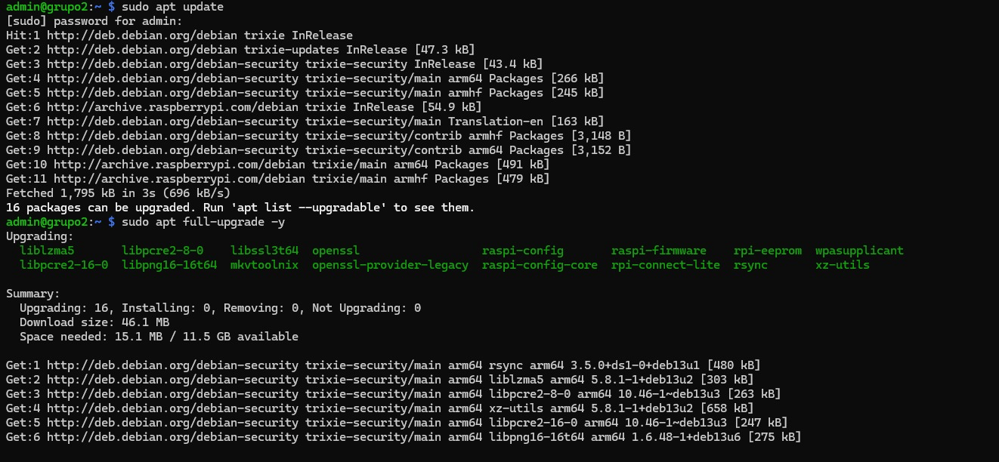
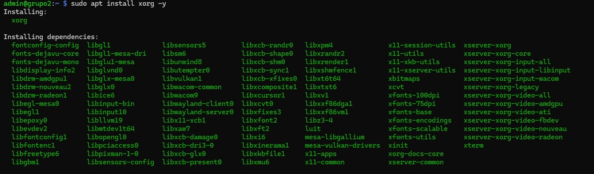
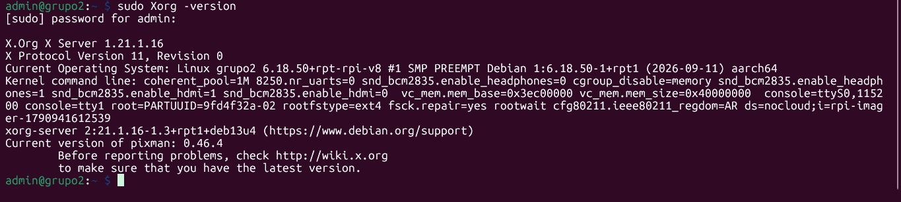
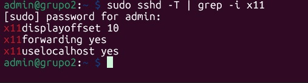
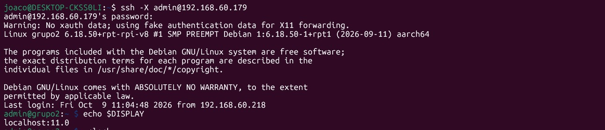
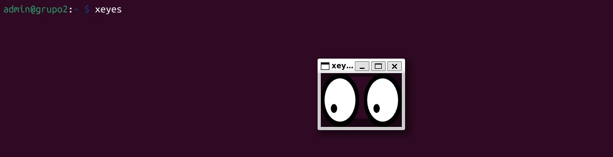
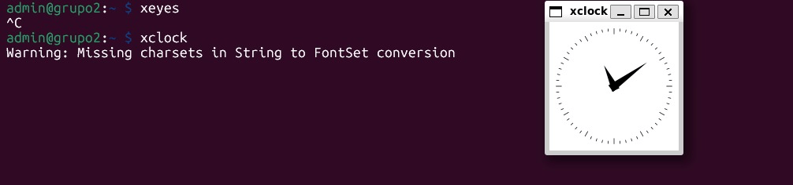
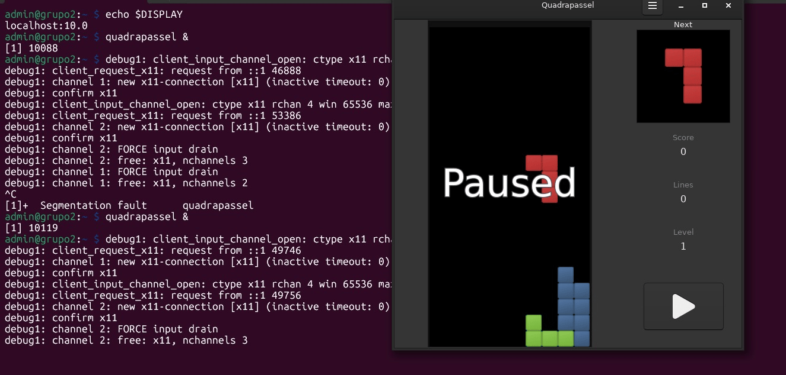

# Instalación del servidor gráfico Xorg y ejecución remota de aplicaciones gráficas por SSH

## Índice

- [Instalación del servidor gráfico Xorg y ejecución remota de aplicaciones gráficas por SSH](#instalación-del-servidor-gráfico-xorg-y-ejecución-remota-de-aplicaciones-gráficas-por-ssh)
  - [Índice](#índice)
  - [1. Introducción](#1-introducción)
  - [2. Objetivo](#2-objetivo)
  - [3. Marco teórico](#3-marco-teórico)
  - [4. Materiales utilizados](#4-materiales-utilizados)
  - [5. Instalación de Xorg](#5-instalación-de-xorg)
    - [Evidencia](#evidencia)
  - [](#)
  - [](#-1)
  - [6. Configuración de SSH para X11 Forwarding](#6-configuración-de-ssh-para-x11-forwarding)
    - [Evidencia](#evidencia-1)
  - [7. Conexión remota con reenvío de X11](#7-conexión-remota-con-reenvío-de-x11)
    - [Evidencia](#evidencia-2)
  - [8. Ejecución de aplicaciones gráficas de prueba](#8-ejecución-de-aplicaciones-gráficas-de-prueba)
    - [Evidencia](#evidencia-3)
  - [](#-2)
  - [](#-3)
  - [9. Conclusión](#9-conclusión)

---

## 1. Introducción

En esta segunda etapa se amplió la Raspberry Pi configurada en la Actividad 1 instalando el servidor gráfico **Xorg**, sin gestor de ventanas ni entorno de escritorio. El objetivo es poder ejecutar aplicaciones gráficas instaladas en la Raspberry Pi a través de una conexión SSH, de manera que las ventanas se muestren en la computadora cliente.

De esta forma la Raspberry Pi sigue funcionando como servidor liviano (sin escritorio), pero con la posibilidad de usar herramientas gráficas de forma remota cuando sea necesario.

---

## 2. Objetivo

Instalar el servidor gráfico Xorg en la Raspberry Pi, sin gestor de ventanas ni gestor de escritorio, y configurar el servicio SSH para reenviar la interfaz gráfica (*X11 Forwarding*), de modo que las aplicaciones gráficas ejecutadas en la Raspberry Pi se visualicen en el equipo cliente.

Objetivos específicos:

- Instalar Xorg y las utilidades necesarias sin entorno de escritorio.
- Comprobar que no se instaló ningún gestor de ventanas ni de escritorio.
- Habilitar y verificar el reenvío de X11 en el servidor SSH.
- Preparar un servidor X en el equipo cliente.
- Conectarse con `ssh -X` y ejecutar aplicaciones gráficas de prueba.
- Verificar que las ventanas se generan en el cliente.

---

## 3. Marco teórico

**Servidor gráfico:** programa encargado de gestionar la pantalla, el teclado y el mouse, y de dibujar las ventanas de las aplicaciones. Sin un servidor gráfico, un sistema solo puede mostrar texto en la terminal.

**X Window System (X11):** sistema de ventanas para entornos Unix/Linux basado en una arquitectura **cliente-servidor**. Una característica importante es su **transparencia de red**: la aplicación y el servidor gráfico pueden estar en equipos distintos.

**Xorg:** implementación libre y más utilizada del servidor X11.

**Servidor X y cliente X:** en la terminología de X11 los roles pueden resultar contraintuitivos:

- **Servidor X:** es el programa que está frente al usuario, maneja la pantalla, el teclado y el mouse, y dibuja las ventanas. En esta actividad corre en la **computadora cliente**.
- **Cliente X:** es la aplicación gráfica (por ejemplo `xclock` o `xeyes`). Envía al servidor X las instrucciones de dibujo. En esta actividad corre en la **Raspberry Pi**.

Es decir que la aplicación se ejecuta (lógica, cálculos, archivos) en la Raspberry Pi, pero el dibujado de las ventanas lo realiza el equipo del usuario.

**Gestor de ventanas y gestor de escritorio:** el gestor de ventanas (por ejemplo Openbox) maneja el aspecto y la posición de las ventanas (bordes, barras de título, mover y redimensionar). El entorno de escritorio (por ejemplo XFCE o GNOME) incluye además panel, menús, aplicaciones y configuración. En esta actividad **no se instala ninguno de los dos**, ya que las ventanas serán gestionadas por el equipo cliente.

**X11 Forwarding sobre SSH:** funcionalidad de SSH que crea un túnel cifrado por el cual viaja el tráfico de X11. Al conectarse con `ssh -X`, SSH define automáticamente la variable de entorno `DISPLAY` en el servidor apuntando al extremo del túnel, y gestiona las credenciales de autenticación de X mediante `xauth`. Así, cualquier aplicación gráfica lanzada en la sesión SSH se mostrará en el servidor X del cliente.

**Variable `DISPLAY`:** indica a las aplicaciones gráficas dónde deben mostrar sus ventanas. Con X11 Forwarding toma un valor similar a `localhost:10.0`.

**`xauth`:** utilidad que administra las credenciales (*cookies*) que autorizan a una aplicación a conectarse a un servidor X.

---

## 4. Materiales utilizados

- Raspberry Pi con Raspberry Pi OS Lite y SSH habilitado (Actividad 1).
- Computadora cliente conectada a la misma red local.
- Servidor X.org en el cliente.
- Cliente SSH.

| Elemento | Dato |
|---|---|
| Modelo de Raspberry Pi | raspberry pi 3 B+ |
| Sistema operativo | Raspberry Pi OS (sin entorno de escritorio) |
| Usuario | admin |
| Nombre del equipo | grupo2 |
| Dirección IP | 192.168.60.212 |
| Servidor X del cliente | Xorg|

---

## 5. Instalación de Xorg

Primero se actualizó la lista de paquetes e instalaron solamente el servidor gráfico y las utilidades necesarias:

```bash
sudo apt update
sudo apt full-upgrade -y
sudo apt install xorg -y 
```

**Explicación del comando:**

- `sudo`: ejecuta el comando con privilegios administrativos.
- `apt update`: actualiza la lista de paquetes disponibles en los repositorios.
- `apt full-upgrade`: actualiza los paquetes instalados a su última versión.
- `apt install`: instala los paquetes indicados.
- `xorg`: metapaquete que instala servidor el grafico Xorg y sus componentes. 
- `y`: responde "si" automaticamente a todas las confirmaciones.

Se verificó la instalación con:

```bash
Xorg -version
```

### Evidencia
 
-----------------------------------------------------------------------------------------------------------------------------------------------------------

-----------------------------------------------------------------------------------------------------------------------------------------------------------



---

## 6. Configuración de SSH para X11 Forwarding

Se consultó la configuración vigente del servidor SSH:

```bash
sudo sshd -T | grep -i x11
```

**Explicación del comando:**

- `sshd -T`: muestra la configuración efectiva del servidor SSH.
- `grep -i x11`: filtra solo las opciones relacionadas con X11.

Resultado obtenido:

```text
[
x11displayoffset 10
x11forwarding yes
x11uselocalhost yes
]
```

### Evidencia



---

## 7. Conexión remota con reenvío de X11

Desde el equipo cliente se realizó la conexión habilitando el reenvío de X11:

```bash
ssh -X admin@192.168.60.179
```

**Explicación del comando:**

- `ssh`: establece una conexión mediante el protocolo SSH.
- `-X`: habilita el reenvío de X11 (*X11 Forwarding*).
- `admin@192.168.60.179`: usuario y dirección IP de la Raspberry Pi.

Una vez autenticado, se comprobó que SSH configuró la variable `DISPLAY`:

```bash
echo $DISPLAY
```

### Evidencia



---

## 8. Ejecución de aplicaciones gráficas de prueba
Dentro de la sesión SSH se ejecutaron tres aplicaciones gráficas: `xeyes` y `xclock` (incluidas en `x11-apps`, de bajo consumo) y el juego `quadrapassel` (un Tetris), que permite probar una aplicación interactiva real.

```bash
xeyes &
xclock &
```
 
**Explicación del comando:**
 
- `xeyes`: aplicación gráfica de prueba (ojos que siguen al cursor).
- `xclock`: muestra un reloj analógico.
- `&`: ejecuta el programa en segundo plano, dejando libre la terminal.

Se instaló el juego sin gestor de ventanas ni entorno de escritorio:
 
```bash
sudo apt install quadrapassel
```
 
Y se ejecutó:
 
```bash
quadrapassel &
```

### Evidencia


-----------------------------------------------------------------------------------------------------------------------------------------------------------

-----------------------------------------------------------------------------------------------------------------------------------------------------------


---
## 9. Conclusión

Se instaló el servidor gráfico Xorg en la Raspberry Pi sin gestor de ventanas ni entorno de escritorio, manteniendo el sistema liviano. Se verificó y habilitó el reenvío de X11 en el servicio SSH y, mediante `ssh -X`, se ejecutaron aplicaciones gráficas en la Raspberry Pi cuyas ventanas se mostraron en el equipo cliente. De esta manera la Raspberry Pi ejecuta la lógica de las aplicaciones, mientras que el dibujado de las ventanas lo realiza el servidor X del cliente, sin necesidad de conectar un monitor al servidor.

---
