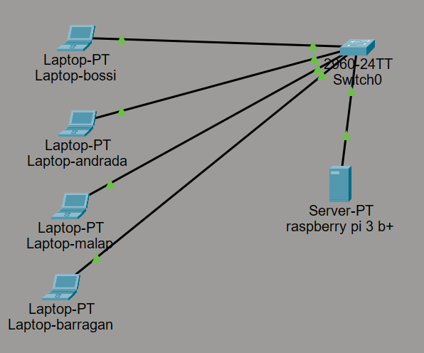
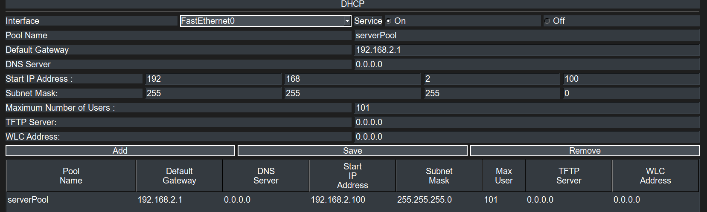
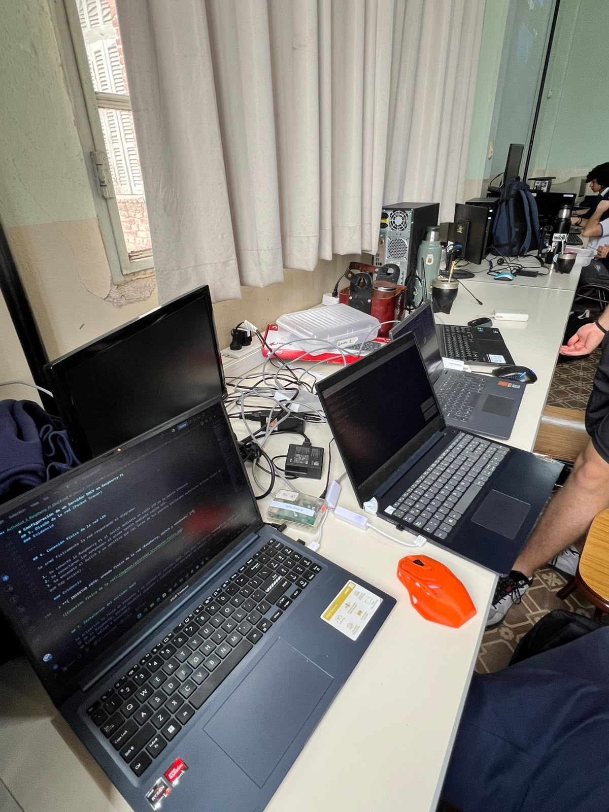
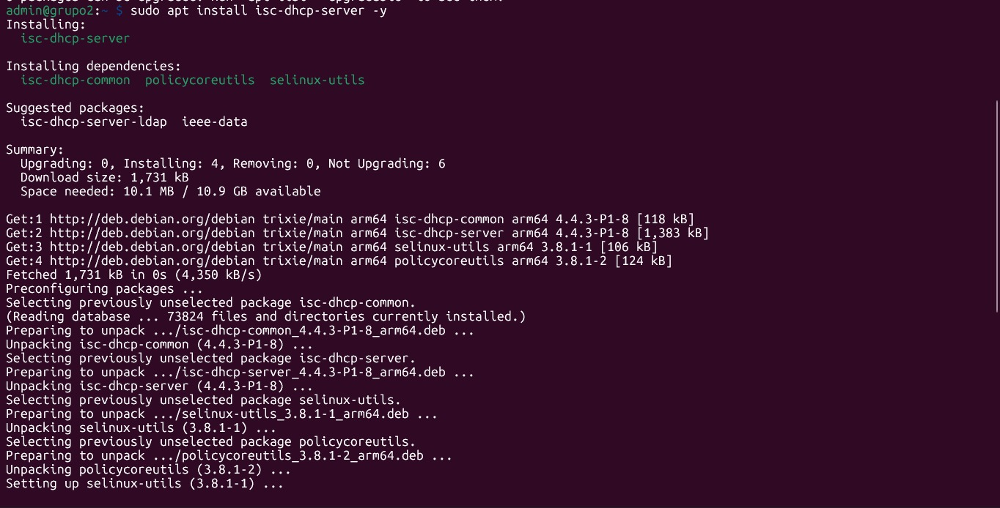
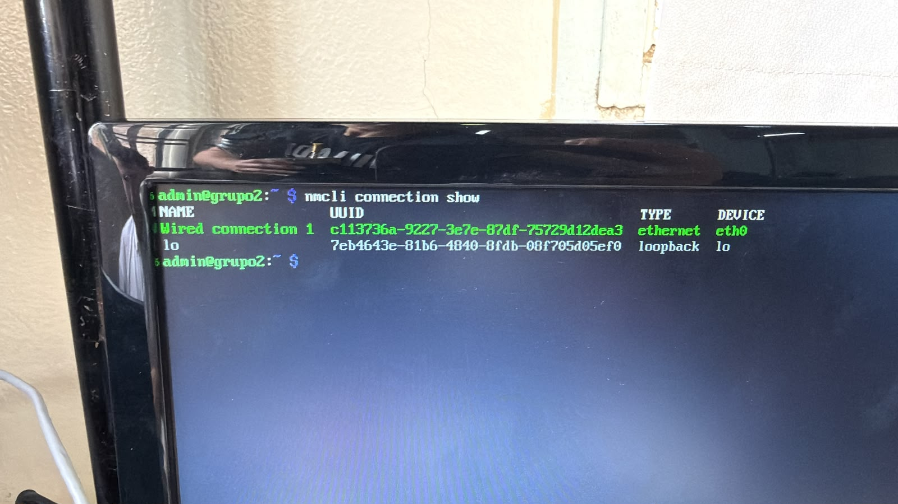
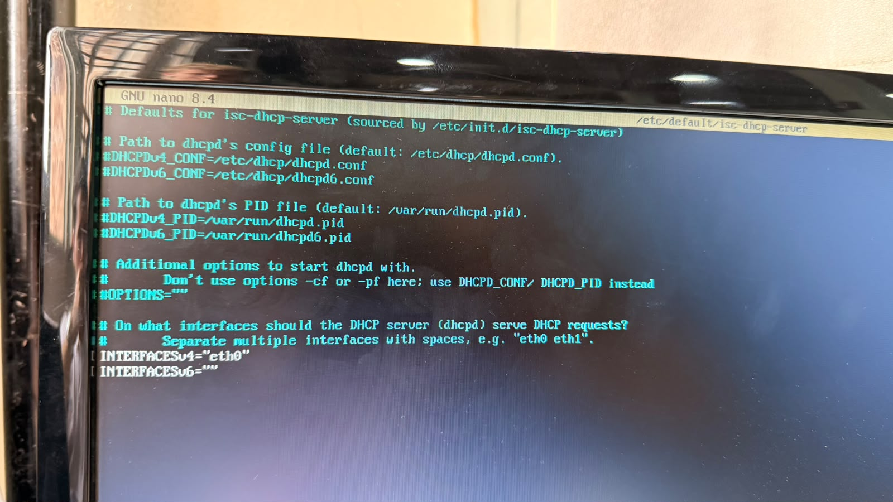
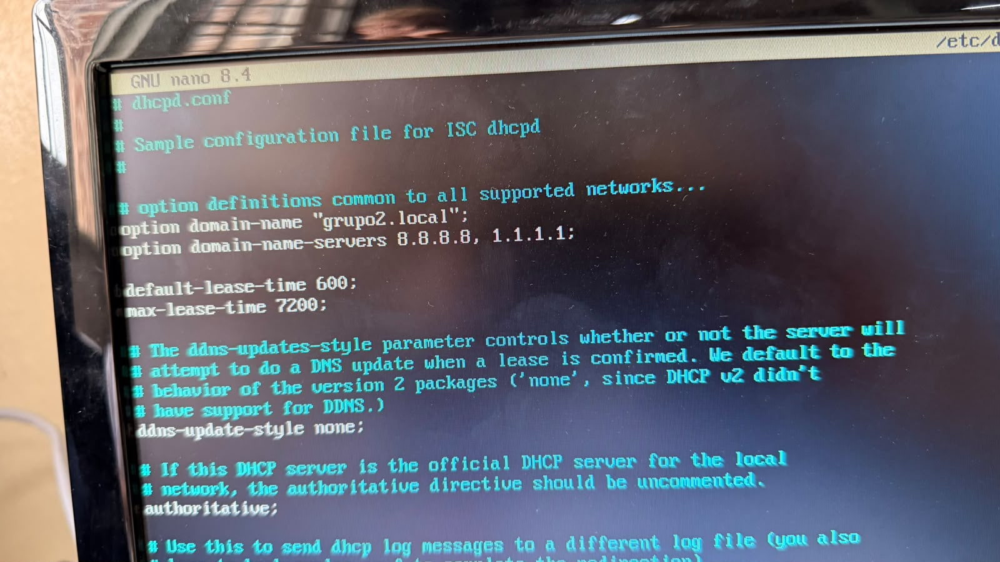
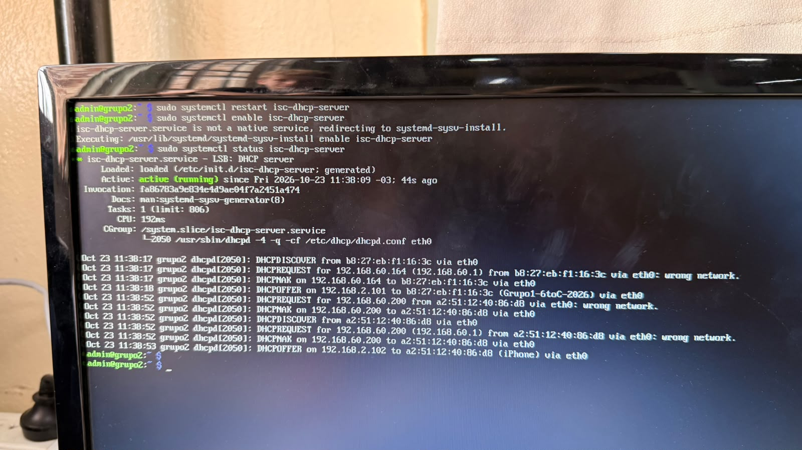

# Configuración de un Servidor DHCP en Raspberry Pi

## Índice

- [Configuración de un Servidor DHCP en Raspberry Pi](#configuración-de-un-servidor-dhcp-en-raspberry-pi)
  - [Índice](#índice)
  - [1. Introducción](#1-introducción)
  - [2. Objetivo](#2-objetivo)
  - [3. Marco teórico](#3-marco-teórico)
  - [4. Materiales utilizados](#4-materiales-utilizados)
  - [5. Diseño de la red (Packet Tracer)](#5-diseño-de-la-red-packet-tracer)
    - [Evidencia](#evidencia)
  - [6. Conexión física de la red LAN](#6-conexión-física-de-la-red-lan)
    - [Evidencia](#evidencia-1)
  - [7. Instalación del servidor DHCP](#7-instalación-del-servidor-dhcp)
    - [Evidencia](#evidencia-2)
  - [8. Asignación de IP estática a la Raspberry Pi](#8-asignación-de-ip-estática-a-la-raspberry-pi)
    - [Evidencia](#evidencia-3)
  - [9. Configuración del servidor DHCP](#9-configuración-del-servidor-dhcp)
    - [9.1 Indicar la interfaz de escucha](#91-indicar-la-interfaz-de-escucha)
    - [9.2 Definir la red y el rango de direcciones](#92-definir-la-red-y-el-rango-de-direcciones)
    - [Evidencia](#evidencia-4)
  - [10. Inicio y habilitación del servicio](#10-inicio-y-habilitación-del-servicio)
    - [Evidencia](#evidencia-5)
  - [11. Verificación del funcionamiento](#11-verificación-del-funcionamiento)
    - [11.1 Desde el cliente (notebook)](#111-desde-el-cliente-notebook)
    - [11.2 Desde la Raspberry Pi (servidor)](#112-desde-la-raspberry-pi-servidor)
  - [12. Conclusión](#12-conclusión)

---

## 1. Introducción

En esta etapa del trabajo se configuró la Raspberry Pi para que cumpla el rol de **servidor DHCP** dentro de la red local (LAN) de nuestro grupo. De esta forma, cada vez que una notebook se conecte al switch del grupo, recibirá automáticamente una dirección IP y el resto de los parámetros de red, sin necesidad de configurarlos a mano.

La red LAN del grupo utiliza el direccionamiento `192.168.2.0/24` (el tercer octeto corresponde al número de grupo).

---

## 2. Objetivo

Instalar y configurar un servidor DHCP en la Raspberry Pi para que asigne direcciones IP de forma automática a los dispositivos conectados a la red LAN del grupo (`192.168.2.0/24`).

Objetivos específicos:

- Diseñar el esquema de la red en Packet Tracer.
- Conectar físicamente la Raspberry Pi y las notebooks al switch del grupo.
- Asignar una dirección IP estática a la Raspberry Pi dentro de la red LAN.
- Instalar el servidor DHCP.
- Configurar la red, el rango de direcciones y los parámetros que se entregarán a los clientes.
- Verificar que las notebooks reciben su configuración automáticamente.

---

## 3. Marco teórico

**DHCP (Dynamic Host Configuration Protocol):** protocolo de red que permite asignar de forma automática y dinámica la configuración de red (dirección IP, máscara, puerta de enlace, servidores DNS) a los dispositivos que se conectan a una red. Funciona bajo el modelo cliente-servidor y utiliza los puertos UDP 67 (servidor) y 68 (cliente).

**Proceso DORA:** es el intercambio de mensajes entre el cliente y el servidor DHCP:

1. **Discover:** el cliente envía un mensaje de difusión (*broadcast*) buscando un servidor DHCP.
2. **Offer:** el servidor responde ofreciendo una dirección IP disponible.
3. **Request:** el cliente solicita formalmente la dirección ofrecida.
4. **Acknowledge:** el servidor confirma la asignación y el cliente comienza a usar la configuración.

**Concesión (*lease*):** tiempo durante el cual el cliente puede usar la dirección IP asignada. Cuando vence, debe renovarla o devolverla al servidor.

**Rango (*range*):** conjunto de direcciones IP que el servidor DHCP tiene permitido entregar a los clientes.

**Máscara de subred:** valor que indica qué parte de la dirección IP identifica a la red y cuál a cada equipo. En `192.168.2.0/24` la máscara es `255.255.255.0`, lo que permite hasta 254 equipos.

**Puerta de enlace (*gateway*):** dispositivo al que los clientes envían el tráfico destinado a otras redes.

**DNS (Domain Name System):** servicio que traduce nombres de dominio (por ejemplo `google.com`) a direcciones IP.

**Switch:** dispositivo de capa 2 que interconecta los equipos de una red local y permite que se comuniquen entre sí. En este trabajo forma la LAN de cada grupo.

**IP estática:** dirección configurada manualmente que no cambia. Un servidor DHCP necesita una IP estática dentro de la red a la que va a brindar servicio.

**isc-dhcp-server:** implementación de servidor DHCP desarrollada por el *Internet Systems Consortium*, disponible en los repositorios de Debian/Raspberry Pi OS.

---

## 4. Materiales utilizados

- Raspberry Pi con Raspberry Pi OS Lite (sin entorno de escritorio).
- Switch del grupo.
- Cables de red (UTP) para la Raspberry Pi y para cada notebook.
- Notebooks de los integrantes (clientes DHCP).
- Software **Cisco Packet Tracer** (diseño del diagrama).

| Elemento | Dato |
|---|---|
| Modelo de Raspberry Pi | Raspberry Pi 3 B+ |
| Nombre del equipo | grupo2 |
| Usuario | admin |
| Interfaz de red utilizada | eth0 |
| Red LAN | 192.168.2.0/24 |
| Máscara de subred | 255.255.255.0 |
| IP estática de la Raspberry Pi | 192.168.2.1 |
| Rango DHCP | 192.168.2.100 – 192.168.2.200 |
| Puerta de enlace entregada | 192.168.2.1 |
| Servidores DNS entregados | 8.8.8.8 y 1.1.1.1 |

---

## 5. Diseño de la red (Packet Tracer)

Antes de configurar el servicio se diseñó el diagrama de la red en **Packet Tracer**. La topología es de tipo estrella: la Raspberry Pi (servidor DHCP) y las notebooks de los integrantes se conectan al mismo switch.

**Paso a paso:**

1. Abrir Packet Tracer y agregar un **switch** (por ejemplo, Switch 2960).
2. Agregar un **servidor** que represente a la Raspberry Pi y conectarlo al switch con un cable de cobre directo.
3. Agregar las **PC/laptops** (una por integrante) y conectarlas al switch.
4. Configurar el servidor con IP estática `192.168.2.1` y máscara `255.255.255.0`.
5. En el servidor, habilitar el servicio DHCP (pestaña *Services > DHCP*) con el rango definido, para simular el funcionamiento.
6. Configurar las PC en modo **DHCP** y comprobar que reciben una IP del rango.
7. Rotular cada dispositivo con su nombre y dirección IP.

### Evidencia





> Archivo adjunto: `raspberrysyt.pkt`

---

## 6. Conexión física de la red LAN

Se armó físicamente la red respetando el diagrama:

1. Se conectó la Raspberry Pi al switch mediante un cable UTP en su puerto Ethernet.
2. Se conectaron las notebooks al mismo switch mediante cables UTP.
3. Se encendió el switch y se verificó que las luces de los puertos utilizados estuvieran activas (señal de que hay enlace).

### Evidencia



---

## 7. Instalación del servidor DHCP

Se actualizó la lista de paquetes y se instaló el servidor DHCP. Este paso se realiza **antes** de cambiar la IP de la Raspberry, porque necesita conexión a internet para descargar el paquete (la red del switch del grupo no tiene salida a internet).

En este momento la Raspberry todavía está conectada a la red del aula/Wi-Fi:

```bash
sudo apt update
```

**Explicación del comando:**

- `sudo`: ejecuta el comando con privilegios de administrador.
- `apt`: gestor de paquetes de sistemas basados en Debian.
- `update`: actualiza la lista de paquetes disponibles en los repositorios.

```bash
sudo apt install isc-dhcp-server -y
```

**Explicación del comando:**

- `install`: instala el paquete indicado junto con sus dependencias.
- `isc-dhcp-server`: paquete del servidor DHCP del *Internet Systems Consortium*.
- `-y`: responde automáticamente "sí" a las confirmaciones.

> **Nota:** durante la instalación el servicio puede mostrar un error al intentar iniciarse. Es normal, ya que todavía no está configurado.

### Evidencia



---

## 8. Asignación de IP estática a la Raspberry Pi

> **Importante:** al cambiar la IP de `eth0` se corta la conexión SSH si se estaba trabajando por cable de red. Para seguir conectado hay dos opciones: usar teclado y monitor en la Raspberry, o conectar la notebook al switch con una IP fija temporal (por ejemplo `192.168.2.10`, máscara `255.255.255.0`) y entrar por `ssh admin@192.168.2.1`. Cuando el DHCP funcione, la notebook vuelve a modo automático.

Un servidor DHCP no puede obtener su dirección de otro servidor DHCP, por lo que se le asignó una dirección IP fija dentro de la red del grupo: `192.168.2.1`.

Primero se consultó el nombre de la conexión de red que gestiona `eth0`:

```bash
nmcli connection show
```

**Explicación del comando:**

- `nmcli`: herramienta de línea de comandos para administrar **NetworkManager**, el gestor de red de Raspberry Pi OS.
- `connection`: indica que se trabajará con las conexiones de red configuradas.
- `show`: lista las conexiones existentes, junto con el dispositivo (`eth0`, `wlan0`, etc.) al que están asociadas.

Luego se configuró la IP estática (reemplazar `Wired connection 1` por el nombre que apareció en el paso anterior):

```bash
sudo nmcli connection modify "Wired connection 1" ipv4.method manual ipv4.addresses 192.168.2.1/24
```

**Explicación del comando:**

- `sudo`: ejecuta el comando con privilegios administrativos.
- `nmcli connection modify`: modifica los parámetros de una conexión existente.
- `"Wired connection 1"`: nombre de la conexión que se va a modificar.
- `ipv4.method manual`: indica que la dirección IPv4 se configurará de forma manual (estática) y no por DHCP.
- `ipv4.addresses 192.168.2.1/24`: define la dirección IP de la Raspberry Pi y su máscara. `/24` equivale a `255.255.255.0`.

Para aplicar los cambios se reinició la conexión:

```bash
sudo nmcli connection down "Wired connection 1" && sudo nmcli connection up "Wired connection 1"
```

**Explicación del comando:**

- `connection down`: desactiva la conexión indicada.
- `&&`: ejecuta el segundo comando solo si el primero terminó correctamente.
- `connection up`: vuelve a activar la conexión con la nueva configuración.

Finalmente se verificó la dirección asignada:

```bash
ip -4 addr show eth0
```

**Explicación del comando:**

- `ip`: herramienta para consultar y configurar interfaces de red.
- `-4`: muestra únicamente direcciones IPv4.
- `addr show eth0`: muestra las direcciones asignadas a la interfaz `eth0`.

### Evidencia



---

## 9. Configuración del servidor DHCP

### 9.1 Indicar la interfaz de escucha

Se editó el archivo que le indica al servicio por qué interfaz debe atender las peticiones:

```bash
sudo nano /etc/default/isc-dhcp-server
```

**Explicación del comando:**

- `sudo`: ejecuta el comando con privilegios de administrador.
- `nano`: editor de texto de terminal.
- `/etc/default/isc-dhcp-server`: archivo donde se define la interfaz en la que escuchará el servidor.

Se modificó la línea `INTERFACESv4` para que apunte a `eth0`, que es la interfaz conectada al switch:

```text
INTERFACESv4="eth0"
```

- `INTERFACESv4`: interfaz (o interfaces) por las que el servidor atenderá solicitudes DHCP de IPv4.
- `"eth0"`: interfaz Ethernet de la Raspberry Pi.

Para guardar en `nano`: `Ctrl + O`, `Enter` y luego `Ctrl + X` para salir.

### 9.2 Definir la red y el rango de direcciones

Antes de modificar el archivo principal, se hizo una copia de seguridad:

```bash
sudo cp /etc/dhcp/dhcpd.conf /etc/dhcp/dhcpd.conf.bak
```

**Explicación del comando:**

- `cp`: copia archivos.
- `/etc/dhcp/dhcpd.conf`: archivo original de configuración del servidor DHCP.
- `/etc/dhcp/dhcpd.conf.bak`: copia de respaldo, por si es necesario volver a la configuración original.

Luego se editó el archivo de configuración:

```bash
sudo nano /etc/dhcp/dhcpd.conf
```

**Explicación del comando:**

- `/etc/dhcp/dhcpd.conf`: archivo principal de configuración de `isc-dhcp-server`.

Contenido configurado:

```text
# Nombre de dominio y servidores DNS que se entregan a los clientes
option domain-name "grupo2.local";
option domain-name-servers 8.8.8.8, 1.1.1.1;

# Tiempos de concesión (en segundos)
default-lease-time 600;
max-lease-time 7200;

# Este servidor es el oficial para esta red
authoritative;

# Definición de la red LAN del grupo 2
subnet 192.168.2.0 netmask 255.255.255.0 {
    range 192.168.2.100 192.168.2.200;
    option routers 192.168.2.1;
    option broadcast-address 192.168.2.255;
}
```

**Explicación de cada línea:**

- `option domain-name "grupo2.local";`: nombre de dominio que reciben los clientes.
- `option domain-name-servers 8.8.8.8, 1.1.1.1;`: servidores DNS que se entregan a los clientes (DNS públicos de Google y Cloudflare).
- `default-lease-time 600;`: tiempo de concesión por defecto, 600 segundos (10 minutos).
- `max-lease-time 7200;`: tiempo máximo de concesión, 7200 segundos (2 horas).
- `authoritative;`: indica que este servidor es el oficial de la red y que debe responder ante solicitudes de direcciones incorrectas.
- `subnet 192.168.2.0 netmask 255.255.255.0 { ... }`: define la red a la que brinda servicio y su máscara.
- `range 192.168.2.100 192.168.2.200;`: rango de direcciones que se entregarán a los clientes.
- `option routers 192.168.2.1;`: puerta de enlace que recibirán los clientes.
- `option broadcast-address 192.168.2.255;`: dirección de difusión de la red.

Para comprobar que el archivo no tiene errores de sintaxis:

```bash
sudo dhcpd -t -cf /etc/dhcp/dhcpd.conf
```

**Explicación del comando:**

- `dhcpd`: ejecutable del servidor DHCP.
- `-t`: modo de prueba; solo verifica la sintaxis del archivo y no inicia el servicio.
- `-cf`: indica la ruta del archivo de configuración a validar.

### Evidencia





---

## 10. Inicio y habilitación del servicio

Se reinició el servicio para que tome la nueva configuración:

```bash
sudo systemctl restart isc-dhcp-server
```

**Explicación del comando:**

- `systemctl`: herramienta para controlar los servicios gestionados por `systemd`.
- `restart`: detiene y vuelve a iniciar el servicio, aplicando los cambios.
- `isc-dhcp-server`: nombre del servicio.

Se habilitó el inicio automático en cada arranque:

```bash
sudo systemctl enable isc-dhcp-server
```

**Explicación del comando:**

- `enable`: configura el servicio para que se inicie junto con el sistema.

Y se comprobó su estado:

```bash
sudo systemctl status isc-dhcp-server
```

**Explicación del comando:**

- `status`: muestra el estado actual del servicio (activo, detenido o con errores).


### Evidencia



---

## 11. Verificación del funcionamiento

### 11.1 Desde el cliente (notebook)

Se conectó una notebook al switch con la interfaz de red en modo automático (DHCP) y se consultó la configuración recibida.

En **Windows**:

```bash
ipconfig /all
```

**Explicación del comando:**

- `ipconfig`: muestra la configuración de red del equipo.
- `/all`: muestra información detallada: IP, máscara, puerta de enlace, servidor DHCP, DNS y datos de la concesión.

En **Linux**:

```bash
ip addr show
```

**Explicación del comando:**

- `ip addr show`: muestra las direcciones IP asignadas a cada interfaz.

Si la notebook ya tenía una IP de otra red, se puede forzar una nueva solicitud en Windows con:

```bash
ipconfig /release
ipconfig /renew
```

- `/release`: libera la dirección IP actual.
- `/renew`: solicita una nueva dirección al servidor DHCP.

Resultado obtenido (debe verse una IP entre `192.168.2.100` y `192.168.2.200` y como servidor DHCP `192.168.2.1`):

### 11.2 Desde la Raspberry Pi (servidor)

Se consultaron las concesiones entregadas por el servidor:

```bash
cat /var/lib/dhcp/dhcpd.leases
```

**Explicación del comando:**

- `cat`: muestra el contenido de un archivo.
- `/var/lib/dhcp/dhcpd.leases`: archivo donde el servidor registra las direcciones entregadas, a qué equipo (dirección MAC) y hasta cuándo.

También se revisó el registro del servicio para ver el proceso DORA:

```bash
sudo journalctl -u isc-dhcp-server -n 20
```

**Explicación del comando:**

- `journalctl`: herramienta para consultar los registros (*logs*) de `systemd`.
- `-u isc-dhcp-server`: filtra los mensajes de ese servicio.
- `-n 20`: muestra solo las últimas 20 líneas.

---

## 12. Conclusión

Se instaló y configuró un servidor DHCP en la Raspberry Pi, que quedó asignada con la IP estática `192.168.2.1` y brinda servicio a la red LAN del grupo (`192.168.2.0/24`), entregando direcciones del rango `192.168.2.100` – `192.168.2.200`, junto con la puerta de enlace y los servidores DNS. Se comprobó que las notebooks conectadas al switch reciben su configuración de red de forma automática, y se documentó el diseño de la red en un diagrama de Packet Tracer.

Con esto, la Raspberry Pi quedó lista para continuar con los siguientes servicios dentro de la red local del grupo.