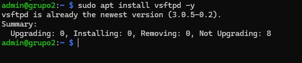
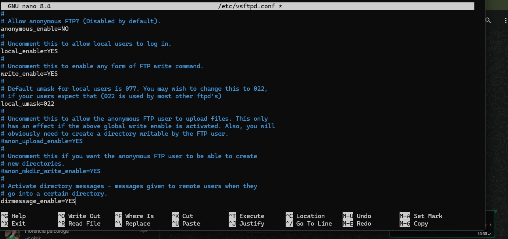
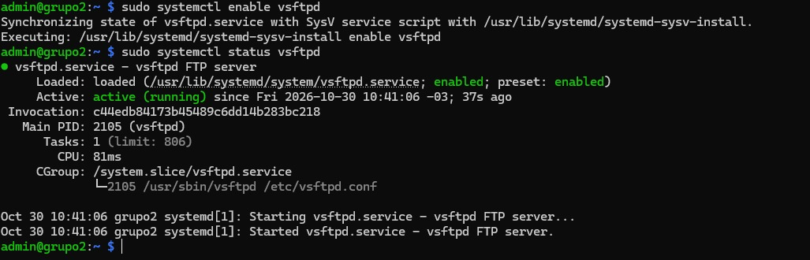
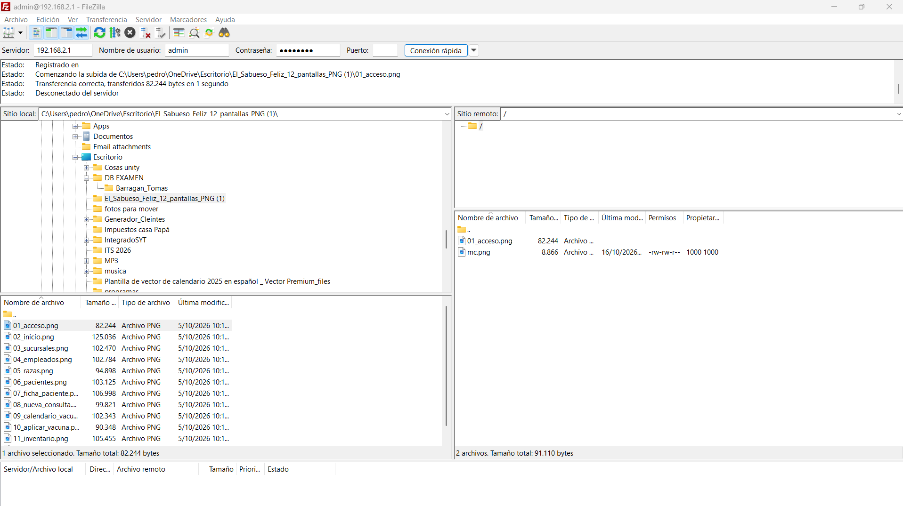

# Instalación y Configuración de un Servidor FTP en Raspberry Pi

## Índice

- [Instalación y Configuración de un Servidor FTP en Raspberry Pi](#instalación-y-configuración-de-un-servidor-ftp-en-raspberry-pi)
  - [Índice](#índice)
  - [1. Introducción](#1-introducción)
  - [2. Objetivo](#2-objetivo)
  - [3. Marco teórico](#3-marco-teórico)
  - [4. Materiales utilizados](#4-materiales-utilizados)
  - [5. Instalación del servidor FTP](#5-instalación-del-servidor-ftp)
    - [Evidencia](#evidencia)
  - [6. Configuración de vsftpd](#6-configuración-de-vsftpd)
    - [Evidencia](#evidencia-1)
  - [7. Inicio y habilitación del servicio](#7-inicio-y-habilitación-del-servicio)
    - [Evidencia](#evidencia-2)
  - [8. Verificación con un cliente FTP (FileZilla)](#8-verificación-con-un-cliente-ftp-filezilla)
    - [8.1 Desde el cliente (notebook)](#81-desde-el-cliente-notebook)
    - [8.2 Desde la Raspberry Pi (servidor)](#82-desde-la-raspberry-pi-servidor)
    - [Evidencia](#evidencia-3)
  - [9. Conclusión](#9-conclusión)

---

## 1. Introducción

En esta etapa del trabajo se configuró la Raspberry Pi para que cumpla el rol de **servidor FTP** dentro de la red local (LAN) de nuestro grupo. De esta forma, las notebooks conectadas al switch pueden subir y descargar archivos hacia la Raspberry Pi desde un cliente FTP.

La red LAN del grupo utiliza el direccionamiento `192.168.2.0/24`, y la Raspberry Pi tiene la IP estática `192.168.2.1`.

---

## 2. Objetivo

Instalar y configurar un servidor FTP (`vsftpd`) en la Raspberry Pi para permitir la transferencia de archivos entre las notebooks y el servidor dentro de la LAN del grupo.

Objetivos específicos:

- Instalar el servidor `vsftpd`.
- Configurar el acceso de usuarios locales con permiso de escritura.
- Iniciar y habilitar el servicio.
- Verificar el funcionamiento desde un cliente FTP (FileZilla).

---

## 3. Marco teórico

**FTP (File Transfer Protocol):** protocolo de red que permite transferir archivos entre un cliente y un servidor. El cliente puede subir archivos al servidor o descargarlos. Funciona bajo el modelo cliente-servidor.

**Puertos FTP:** el puerto **21** se usa para el canal de control (autenticación y comandos) y el puerto **20** (modo activo) o un puerto alto (modo pasivo) para transferir los datos.

**vsftpd (Very Secure FTP Daemon):** servidor FTP liviano, estable y seguro, muy usado en sistemas Linux y disponible en los repositorios de Raspberry Pi OS.

**Cliente FTP:** aplicación que se conecta al servidor. En este trabajo se usó **FileZilla** (alternativa: WinSCP).

**Usuario local:** cuenta existente en el sistema operativo de la Raspberry Pi que se utiliza para iniciar sesión en el servidor FTP.

**Acceso anónimo:** permite entrar sin usuario ni contraseña. Se deshabilita por seguridad.

**Chroot:** restringe al usuario a su carpeta personal, impidiendo que explore el resto del sistema de archivos.

> **Nota:** FTP envía usuario, contraseña y datos **sin cifrar**. Por eso conviene usarlo solo en redes controladas como nuestra LAN. Para entornos reales existen alternativas cifradas como FTPS o SFTP.

---

## 4. Materiales utilizados

- Raspberry Pi con Raspberry Pi OS Lite, con IP estática y servidor DHCP ya configurados.
- Switch del grupo y cables UTP.
- Notebook de los integrantes (cliente FTP) con **FileZilla**.

| Elemento | Dato |
|---|---|
| Nombre del equipo | grupo2 |
| Usuario | admin |
| Servidor FTP | vsftpd |
| Red LAN | 192.168.2.0/24 |
| IP de la Raspberry Pi (servidor FTP) | 192.168.2.1 |
| Puerto | 21 |

---

## 5. Instalación del servidor FTP

Se actualizó la lista de paquetes y se instaló `vsftpd`. Este paso requiere **conexión a internet** (la red del switch del grupo no tiene salida), por lo que se realiza con la Raspberry conectada a la red del aula/Wi-Fi:

```bash
sudo apt update
```

**Explicación del comando:**

- `sudo`: ejecuta el comando con privilegios de administrador.
- `apt`: gestor de paquetes de sistemas basados en Debian.
- `update`: actualiza la lista de paquetes disponibles en los repositorios.

```bash
sudo apt install vsftpd -y
```

**Explicación del comando:**

- `install`: instala el paquete indicado junto con sus dependencias.
- `vsftpd`: paquete del servidor FTP.
- `-y`: responde automáticamente "sí" a las confirmaciones.

### Evidencia



---

## 6. Configuración de vsftpd

Antes de modificar el archivo principal, se hizo una copia de seguridad:

```bash
sudo cp /etc/vsftpd.conf /etc/vsftpd.conf.bak
```

**Explicación del comando:**

- `cp`: copia archivos.
- `/etc/vsftpd.conf`: archivo de configuración original de vsftpd.
- `/etc/vsftpd.conf.bak`: copia de respaldo, por si hay que volver a la configuración original.

Luego se editó el archivo de configuración:

```bash
sudo nano /etc/vsftpd.conf
```

**Explicación del comando:**

- `nano`: editor de texto de terminal.
- `/etc/vsftpd.conf`: archivo principal de configuración del servidor.

Se verificaron o modificaron las siguientes líneas (si alguna estaba comentada con `#`, se quitó el símbolo; si no existía, se agregó al final del archivo):

```text
anonymous_enable=NO
local_enable=YES
write_enable=YES
local_umask=022
chroot_local_user=YES
allow_writeable_chroot=YES
```

**Explicación de cada línea:**

- `anonymous_enable=NO`: deshabilita el acceso anónimo.
- `local_enable=YES`: permite iniciar sesión con los usuarios locales de la Raspberry Pi.
- `write_enable=YES`: permite escribir, es decir, subir, borrar y renombrar archivos.
- `local_umask=022`: define los permisos de los archivos subidos (propietario lee y escribe; el resto solo lee).
- `chroot_local_user=YES`: encierra a cada usuario en su carpeta personal (`/home/admin`).
- `allow_writeable_chroot=YES`: permite que esa carpeta tenga permiso de escritura; sin esto vsftpd rechaza la conexión.

Para guardar en `nano`: `Ctrl + O`, `Enter` y luego `Ctrl + X` para salir.

### Evidencia



---

## 7. Inicio y habilitación del servicio

Se reinició el servicio para que tome la nueva configuración:

```bash
sudo systemctl restart vsftpd
```

**Explicación del comando:**

- `systemctl`: herramienta para controlar los servicios gestionados por `systemd`.
- `restart`: detiene y vuelve a iniciar el servicio, aplicando los cambios.
- `vsftpd`: nombre del servicio.

Se habilitó el inicio automático en cada arranque:

```bash
sudo systemctl enable vsftpd
```

**Explicación del comando:**

- `enable`: configura el servicio para que se inicie junto con el sistema.

Se comprobó su estado:

```bash
sudo systemctl status vsftpd
```

**Explicación del comando:**

- `status`: muestra el estado actual del servicio (activo, detenido o con errores). Debe aparecer `active (running)`.

Y se verificó que el servidor esté escuchando en el puerto 21:

```bash
sudo ss -tlnp | grep :21
```

**Explicación del comando:**

- `ss`: muestra información de los puertos y conexiones de red.
- `-t`: solo conexiones TCP. `-l`: solo puertos en escucha. `-n`: muestra números en lugar de nombres. `-p`: muestra el proceso asociado.
- `grep :21`: filtra la salida para mostrar únicamente el puerto 21.

### Evidencia



---

## 8. Verificación con un cliente FTP (FileZilla)

### 8.1 Desde el cliente (notebook)

Con la notebook conectada al switch (recibiendo IP por DHCP), se abrió **FileZilla** y se completaron los datos de conexión en la barra superior:

| Campo | Valor |
|---|---|
| Servidor (Host) | `192.168.2.1` |
| Nombre de usuario | `admin` |
| Contraseña | la del usuario `admin` de la Raspberry |
| Puerto | `21` |

Luego se presionó **Conexión rápida**. En el panel derecho (sitio remoto) aparece la carpeta personal de la Raspberry Pi. Se probó la transferencia arrastrando un archivo de prueba desde el panel izquierdo (equipo local) al derecho (servidor), y también descargando un archivo en sentido contrario.

> Si FileZilla muestra una advertencia sobre conexión no cifrada, es normal: FTP común no utiliza cifrado.

### 8.2 Desde la Raspberry Pi (servidor)

Se comprobó que el archivo subido está en la carpeta del usuario:

```bash
ls -l /home/admin
```

**Explicación del comando:**

- `ls`: lista el contenido de un directorio.
- `-l`: muestra el formato largo (permisos, propietario, tamaño y fecha).
- `/home/admin`: carpeta personal del usuario `admin`, donde llegan los archivos subidos.

### Evidencia



---

## 9. Conclusión

Se instaló y configuró el servidor FTP `vsftpd` en la Raspberry Pi (`192.168.2.1`), deshabilitando el acceso anónimo y permitiendo el ingreso con usuario local con permisos de escritura y restringido a su carpeta personal. Se comprobó, mediante FileZilla, que las notebooks de la LAN pueden conectarse, subir y descargar archivos correctamente.

Como lección aprendida, se destaca que FTP transmite la información sin cifrar, por lo que su uso es adecuado dentro de una red local controlada. Con esto, la Raspberry Pi quedó lista para continuar con los siguientes servicios de la red del grupo.